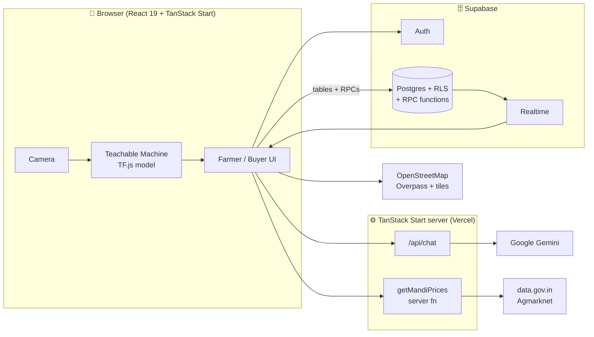

# 🌾 FreshGrid — Scan · Store · Sell

**An agri-tech app for Indian smallholder farmers and FPOs (Farmer Producer Organisations).**
Farmers grade their produce with an on-device AI model, book a nearby cold room, check live government mandi prices, and sell graded lots to buyers through an escrow-style flow. The app works in **Hindi and English**.

🔗 **Live demo:** https://freshgrid-app-final.vercel.app
📂 **Docs:** [Architecture](docs/ARCHITECTURE.md) · [Demo walkthrough for judges](docs/DEMO.md)

> **Hackathon prototype.** No real money moves. All payments are **test payments**, and some steps are simulated.
> The [What's real and what's simulated](#-whats-real-and-whats-simulated) section lists each one.

---

## 📌 The problem

Many Indian smallholder farmers lose a large share of their perishable harvest after it is picked, and sell what is left at a low price:

- **No cold storage nearby**, or no easy way to find and book it, so produce spoils within days.
- **No objective grading**, so good produce gets the same low price as bad.
- **Poor price information**, so the farmer sells at whatever the local middleman offers.
- **Long commission chains** and late or uncertain payment.

## 💡 Our solution

FreshGrid gives the farmer one phone app covering the whole path from harvest to sale:

| Step | What the farmer does | How FreshGrid helps |
|---|---|---|
| **1. Scan** | Points the phone camera at a crate | An AI image model grades the produce **A / B / C** and issues a digital grade certificate |
| **2. Store** | Books a cold room | A map of nearby cold rooms with prices and free slots, plus real nearby cold stores and mandis from OpenStreetMap |
| **3. Price** | Checks today's rate | Live **Agmarknet** modal prices (Govt. of India, data.gov.in) for the farmer's state |
| **4. Sell** | Lists a graded lot | Buyers order and pay into escrow. Money is released only after the buyer enters the farmer's secret **6-digit delivery code** |
| **5. Plan** | Compares income | An estimator compares a traditional mandi sale with the FreshGrid route |
| **6. Ask** | Asks a question in Hindi or English | **Kisan Sahayak**, an AI assistant that answers using the farmer's own scans, bookings, lots and live prices |

---

## ✨ Features

### For farmers (`Shell.tsx`)
- 🔍 **AI crate scan** ([`ScanTab.tsx`](src/components/fg/ScanTab.tsx)): two [Teachable Machine](https://teachablemachine.withgoogle.com/) image models (one for apple, one for tomato and potato) run **in the browser** with TensorFlow.js. The result is saved as a grade certificate.
- ❄️ **Cold room booking** ([`ColdTab.tsx`](src/components/fg/ColdTab.tsx), [`ColdMap.tsx`](src/components/fg/ColdMap.tsx)): Leaflet map, GPS location, free-slot counts, Google Maps directions. Prices and capacity are checked on the server.
- 💰 **Payments and Kisan khata** ([`PayTab.tsx`](src/components/fg/PayTab.tsx)): pay storage dues, list lots for sale, see the delivery code, cancel open lots.
- 📈 **Income estimator** ([`IncomeTab.tsx`](src/components/fg/IncomeTab.tsx), [`income.ts`](src/lib/income.ts)): side-by-side comparison of a traditional sale and the FreshGrid route.
- 🤖 **Kisan Sahayak assistant** ([`AssistTab.tsx`](src/components/fg/AssistTab.tsx), [`ai.server.ts`](src/lib/ai.server.ts)): streamed AI chat (Google Gemini) that answers using the farmer's own data.

### For buyers (`BuyerShell.tsx`)
- 🛒 **Market** of open graded lots, filterable by crop, with today's mandi price shown next to each lot.
- 🔒 **Escrow orders**: the buyer pays, and payment is released only after delivery is confirmed with the farmer's 6-digit code. The code is checked on the server, with a 5-attempt lockout.
- ⚡ **Realtime updates**: new lots appear on the buyer's screen immediately (Supabase Realtime).

### Across the app
- 🇮🇳 Hindi and English throughout, adjustable text size, mobile and desktop layouts.
- 👤 Email or Google sign-in, separate farmer and buyer roles, and a one-time profile setup (village, UPI ID, farmer ID).

---

## ✅ What's real and what's simulated

We want judges to know exactly what works today and what is mocked.

| Area | Status | Details |
|---|---|---|
| Sign-in, roles, profiles | ✅ **Real** | Supabase Auth with Postgres row-level security |
| AI grading (apple, tomato, potato) | ✅ **Real model** | Our Teachable Machine models run in the browser. ⚠️ Small hackathon-sized training sets, **not validated** against official grading standards |
| AI grading (other crops / no camera / model fails) | 🟡 **Simulated** | Falls back to a **random grade**, and the app shows a "simulated scan" message. See `ScanTab.tsx` |
| Grade certificate details (uniformity, spoilage, shelf life) | 🟡 **Derived from the grade** | Fixed values per grade, not measured |
| Live mandi prices | ✅ **Real** | Agmarknet API on data.gov.in (needs `DATA_GOV_IN_API_KEY`). Without a key, the app falls back to fixed rates in [`crops.ts`](src/lib/crops.ts) |
| Nearby cold stores and mandis on the map | ✅ **Real** | OpenStreetMap Overpass API. Depends on how complete OSM data is in each area |
| Bookable cold rooms (Sonipat, Karnal, Panipat, Delhi…) | 🟡 **Sample data** | Seeded demo listings in the first database migration. **Not real businesses, no partnerships.** Their badges (e.g. "FPO Certified") are illustrative |
| Booking amounts, slot capacity, lot totals | ✅ **Real logic** | Calculated on the server (Postgres functions), so the browser can't change prices |
| UPI / QR / KCC payments | 🔴 **Simulated** | No payment gateway. "Payment" is a timed animation and the UTR is a random test number. No money moves |
| Escrow | 🟡 **Logic only** | State machine (open → escrow → settled) with a secret handover code. No funds are actually held |
| Farmer ID (Aadhaar / KCC / PM-Kisan) "Verify" | 🔴 **Not verified** | Only stores the number. No government API is called. The app says "Govt. verification will be done by your FPO" |
| UPI ID "Check" | 🔴 **Format check only** | Checks the format and guesses the bank from the handle. Does not contact NPCI |
| Kisan Sahayak AI | ✅ **Real** | Google Gemini (needs `GEMINI_API_KEY`). Told not to invent numbers, and to say payments are test-only |
| Income estimator | 🟡 **Model with assumptions** | Uses our assumed loss, commission and transport rates (below), not field data |

### Income estimator assumptions ([`src/lib/income.ts`](src/lib/income.ts))

| | Traditional mandi | FreshGrid route |
|---|---|---|
| Post-harvest loss | 38% | 8% (graded + cold storage) |
| Commission | 12% | 8% |
| Transport | ₹3.5 / kg | ₹2.2 / kg |
| Other fees | ₹1.058 / kg | — |
| Cold storage | — | ₹18 per 20 kg crate per day |
| Escrow fee | — | ₹104 flat |

Example (1,000 kg tomato at ₹30/kg, 3 days of storage): **₹11,810 → ₹20,388 (+73%)**. This exact case is covered by [`src/test/income.test.ts`](src/test/income.test.ts).
These rates are our **estimates for the demo**. They would need checking with real FPO data before anyone relies on them.

---

## 🏗️ How it works



The full data model, money flow and security design are in **[docs/ARCHITECTURE.md](docs/ARCHITECTURE.md)**.

### Tech stack

| Layer | Tools |
|---|---|
| Frontend | React 19, TanStack Start / Router / Query, Tailwind CSS 4, shadcn/ui (Radix), Recharts |
| AI / ML | TensorFlow.js + Teachable Machine (in the browser), Google Gemini (assistant) |
| Maps | Leaflet, react-leaflet, OpenStreetMap, Overpass API |
| Backend | Supabase (Postgres, Auth, Realtime, row-level security, PL/pgSQL RPCs) |
| Data | Agmarknet daily prices from [data.gov.in](https://data.gov.in) |
| Tooling | Vite 8, TypeScript, Vitest, ESLint, Prettier, Bun |
| Hosting | Vercel |

---

## 🚀 Run it locally

**You need:** Node.js 20+ (or Bun) and a Supabase project.

```bash
git clone https://github.com/yellow1flash1/FRESHGRID_APP_FINAL.git
```

```bash
cd FRESHGRID_APP_FINAL && npm install
```

```bash
cp .env.example .env
```

Fill in `.env` (see the table below), apply the SQL files in [`drizzle/migrations/`](drizzle/migrations) to your Supabase database in order, then:

```bash
npm run dev
```

### Environment variables

| Variable | Required | Used for |
|---|---|---|
| `VITE_SUPABASE_URL`, `VITE_SUPABASE_PUBLISHABLE_KEY`, `VITE_SUPABASE_PROJECT_ID` | ✅ | Browser Supabase client |
| `SUPABASE_URL`, `SUPABASE_PUBLISHABLE_KEY`, `SUPABASE_PROJECT_ID` | ✅ | Server-side checks (e.g. confirming the user is signed in for `/api/chat`) |
| `GEMINI_API_KEY` | Optional | Kisan Sahayak assistant |
| `DATA_GOV_IN_API_KEY` | Optional | Live mandi prices ([free key](https://data.gov.in)) |

The Supabase *publishable* (anon) key is meant to be public, and access is protected by row-level security. **Never** commit a `service_role` key or the Gemini / data.gov.in keys.

### Scripts

| Command | What it does |
|---|---|
| `npm run dev` | Start the dev server |
| `npm run build` | Production build |
| `npm test` | Run the Vitest tests (income model + routing) |
| `npm run lint` | ESLint |

---

## 📁 Project structure

```
src/
├─ routes/
│  ├─ index.tsx            # Entry: sign-in → profile setup → Farmer or Buyer app
│  ├─ api/chat.ts          # POST /api/chat → Kisan Sahayak (streamed)
│  └─ reset-password.tsx
├─ components/fg/          # FreshGrid screens
│  ├─ Auth.tsx  Onboarding.tsx  TopBar.tsx
│  ├─ Shell.tsx            # Farmer app: Scan · Store · Pay · Income · Help tabs
│  ├─ ScanTab.tsx          # Camera + AI grading + grade certificate + list a lot
│  ├─ ColdTab.tsx  ColdMap.tsx   # Cold room booking + map
│  ├─ PayTab.tsx  UpiPay.tsx     # Dues, lots, delivery code, (simulated) UPI
│  ├─ IncomeTab.tsx  AssistTab.tsx
│  └─ BuyerShell.tsx       # Buyer market + escrow orders
├─ lib/
│  ├─ crops.ts             # Supported crops, storage temperatures, fallback prices
│  ├─ income.ts            # Income comparison model
│  ├─ mandi.functions.ts   # Agmarknet server function
│  ├─ realPlaces.ts        # OpenStreetMap Overpass lookup
│  ├─ ai.server.ts         # Gemini streaming chat
│  ├─ data.ts  store.tsx   # Data hooks, auth/session, language
├─ components/ui/          # shadcn/ui building blocks
└─ test/                   # Vitest tests
drizzle/migrations/        # Postgres schema, RLS policies, RPCs, seed data
```

---

## ⚠️ Known limitations

- The AI grading models were trained on small datasets and cover only **apple, tomato and potato**. Other crops get a simulated grade.
- **No real payment gateway.** Before real use, the "paid" step must come from a gateway webhook (see the note in `drizzle/migrations/0001_secure_money_flows.sql`).
- Farmer ID and UPI checks are not connected to government or NPCI systems.
- Bookable cold rooms are sample data covering a few districts in Haryana and Delhi.
- The profile form's state and district lists cover only six states.
- Only a small amount of automated testing (income model and routing).

## 🛣️ Roadmap

1. Connect a real UPI / payment gateway with webhook-confirmed escrow.
2. Train grading models on larger, labelled datasets that follow AGMARK grading rules, and add more crops.
3. Sign up real cold storage partners through FPOs and use live sensor data for slots and temperature.
4. Add voice input in Hindi and regional languages for farmers who can't read easily, plus offline support.
5. Connect with e-NAM so graded lots can be listed on the national market.

---

## 🧾 Accountability and credits

- **Built by:** Rahul Rajpal ([@yellow1flash1](https://github.com/yellow1flash1)) for the hackathon.
- **AI tools used in development:** this documentation was drafted with Claude. The product idea, the grading models and the product decisions are ours.
- **Open data and services:** [Agmarknet / data.gov.in](https://data.gov.in) (Govt. of India Open Data), [OpenStreetMap](https://www.openstreetmap.org/copyright) contributors (© ODbL), [Teachable Machine](https://teachablemachine.withgoogle.com/), Google Gemini, Supabase.
- **Privacy:** profile data (phone, village, ID number, UPI ID) is stored in Supabase, and each user can read only their own rows (row-level security). This is a prototype: please don't enter real Aadhaar numbers.
- **Not affiliated** with NPCI, e-NAM, Agmarknet or any government body. Names of government schemes are used only to describe what the app is meant to work with.
