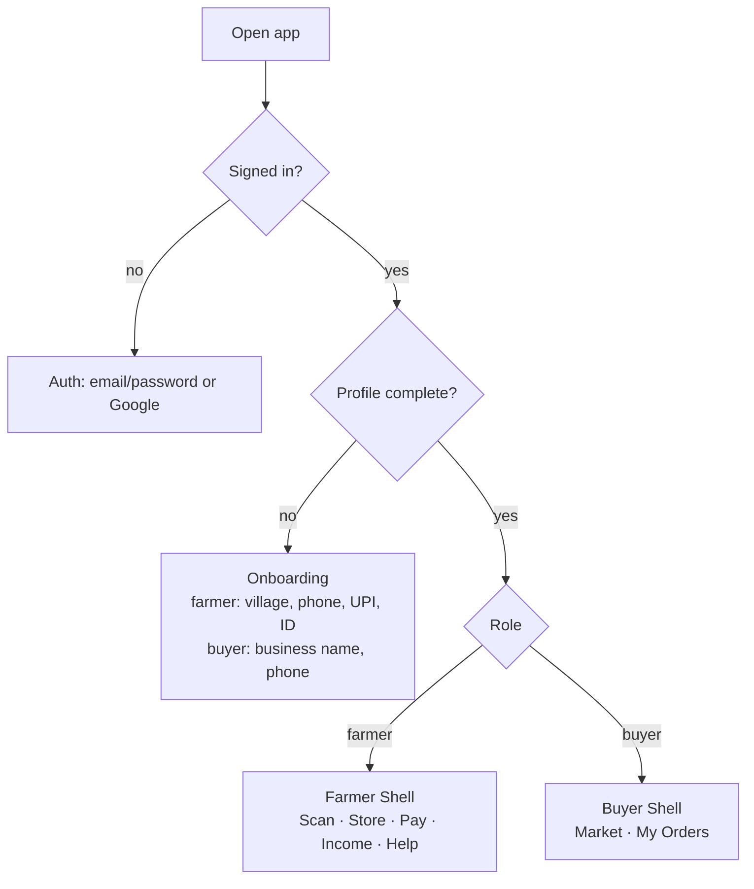
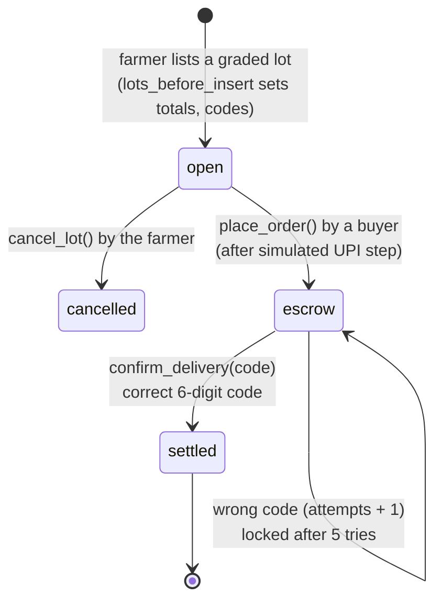

# FreshGrid architecture

This document explains how FreshGrid is built, how data and (test) money move through it, and which checks happen where.
For an overview, see the [README](../README.md).

## 1. Overview

FreshGrid is a single **TanStack Start** app (React 19 with server routes) deployed on Vercel, backed by **Supabase**.

| Concern | Where it runs | Code |
|---|---|---|
| UI, routing, language | Browser | `src/routes/index.tsx`, `src/components/fg/*` |
| Produce grading (AI) | **Browser**, TensorFlow.js | `src/components/fg/ScanTab.tsx` |
| Mandi prices | Server function → data.gov.in | `src/lib/mandi.functions.ts` |
| AI assistant | Server route `/api/chat` → Gemini | `src/routes/api/chat.ts`, `src/lib/ai.server.ts` |
| Nearby real places | Browser → OpenStreetMap Overpass | `src/lib/realPlaces.ts` |
| Auth, data, business rules | Supabase Postgres (RLS + PL/pgSQL) | `drizzle/migrations/*.sql` |
| Live lot updates | Supabase Realtime | `useLots()` in `src/lib/data.ts` |

**Design principle:** the browser is not trusted with anything that involves money. Prices, totals, capacity and payment state are worked out inside Postgres functions, and the browser can only ask for them.

## 2. App flow



A user's role (`farmer` or `buyer`) is set once, either at sign-up through the `handle_new_user` trigger or later through `claim_role()`. The role decides which screens and database actions are available to them.

## 3. Data model

```mermaid
erDiagram
  profiles ||--o{ scans : "farmer has"
  profiles ||--o{ bookings : "farmer has"
  profiles ||--o{ lots : "farmer lists / buyer buys"
  cold_rooms ||--o{ bookings : "booked in"
  lots ||--o| lot_handover : "secret code"
  profiles ||--|| user_roles : "has role"

  profiles { uuid id PK; text full_name; text phone; text state; text district; text village; text org_name; text upi_id; text id_type; text id_number; text fpo_id }
  user_roles { uuid user_id; app_role role }
  cold_rooms { uuid id PK; text name; float lat; float lng; int rate_per_crate_day; int total_slots; float temp_c }
  scans { uuid id PK; uuid farmer_id; text crop; text grade; int confidence; text batch_code }
  bookings { uuid id PK; uuid farmer_id; uuid cold_room_id; int crates; int days; int amount; text pay_mode; bool paid; text pass_no }
  lots { uuid id PK; uuid farmer_id; text crop; int kg; text grade; numeric price_per_kg; int gross; int net_amount; text status; uuid buyer_id; text utr }
  lot_handover { uuid lot_id PK; uuid farmer_id; text code; int attempts }
```

`cold_rooms` is filled with **sample** listings in `0000_migration.sql`, for the demo only.

## 4. Lot and escrow lifecycle



- When a lot is created, a trigger stores a random **6-digit handover code** in `lot_handover`. Only the farmer can read that table, through RLS. Buyers have no access to it.
- At delivery the farmer reads the code out to the buyer. The buyer enters it, and `confirm_delivery()` checks it on the server.
- After **5 wrong attempts** the lot is locked. The farmer can issue a new code with `regenerate_handover_code()`.
- Codes work only once. On success the lot is marked `settled` with a **test** UTR from `test_utr()`.

## 5. Security model

| Table / function | Who can do what |
|---|---|
| `profiles` | Users can read and write **only their own** row |
| `user_roles` | Read own role. Set it once via `claim_role()` |
| `cold_rooms` | Anyone can read. Nobody can write from the client |
| `scans` | Farmer owns their own rows |
| `bookings` | Read own rows. **No direct insert or update**: only `create_booking()` (price comes from the DB, the room row is locked so it can't be overbooked) and `pay_booking_dues()` |
| `lots` | Farmers insert (the trigger overwrites totals, codes and status). Buyers see `open` lots and their own. **No direct update**: only `place_order()`, `cancel_lot()`, `confirm_delivery()` |
| `lot_handover` | Farmer can read their own code. Buyers have no access |
| `/api/chat` | Checks the caller's Supabase access token before calling Gemini. Message count and length are capped |

All `SECURITY DEFINER` functions set `search_path = public` and are revoked from `anon`.

### Known gaps (honest list)
- **Payment confirmation is trusted from the client.** `create_booking(_pay_mode='upi')` marks a booking paid, and `place_order()` runs, after the *simulated* UPI screen. Before real use, these must be triggered by a payment-gateway webhook running as `service_role`.
- Farmer ID numbers are stored as plain text and are not verified.
- Mandi prices fall back to Haryana when the user's state returns no records.

## 6. AI components

### Produce grading
- Two Google Teachable Machine image classifiers, loaded from `teachablemachine.withgoogle.com` and run in the browser:
  - Apple model: `grade a apple`, `grade b or c apple`
  - Tomato & potato model: `grade a/b/c tomato`, `potato good condition`, `potato grade b/c bad condition`, `others`
- The app runs both models and keeps the most confident answer, which also sets the crop.
- **Fallback:** if there is no camera or the model fails to load, the grade is **random** (weighted toward A) and a "simulated scan" message is shown.
- Fields such as uniformity, spoilage and shelf life are **fixed values per grade**, not measured.

### Kisan Sahayak
- Gemini model (`MODEL` in `ai.server.ts`), streamed as plain text. If no Gemini key is set, it can fall back to an optional AI gateway.
- The browser sends a "farmer context" summary (scans, bookings, lots, cold rooms, prices), capped at 6,000 characters. The system prompt tells the model to use only those numbers and to say that payments are test-only.

## 7. External services

| Service | Purpose | Key needed | If it fails |
|---|---|---|---|
| Supabase | Auth, DB, realtime | Publishable key | App can't work |
| data.gov.in Agmarknet | Mandi modal / min / max prices | `DATA_GOV_IN_API_KEY` | Fallback rates from `crops.ts` |
| OpenStreetMap Overpass | Real cold stores / mandis nearby | None (tries 3 mirrors) | Only sample cold rooms shown |
| OSM tiles | Map display | None | Map is blank |
| Google Gemini | Assistant | `GEMINI_API_KEY` | Assistant shows "not set up" |
| Teachable Machine | Grading models | None | Simulated grade |
